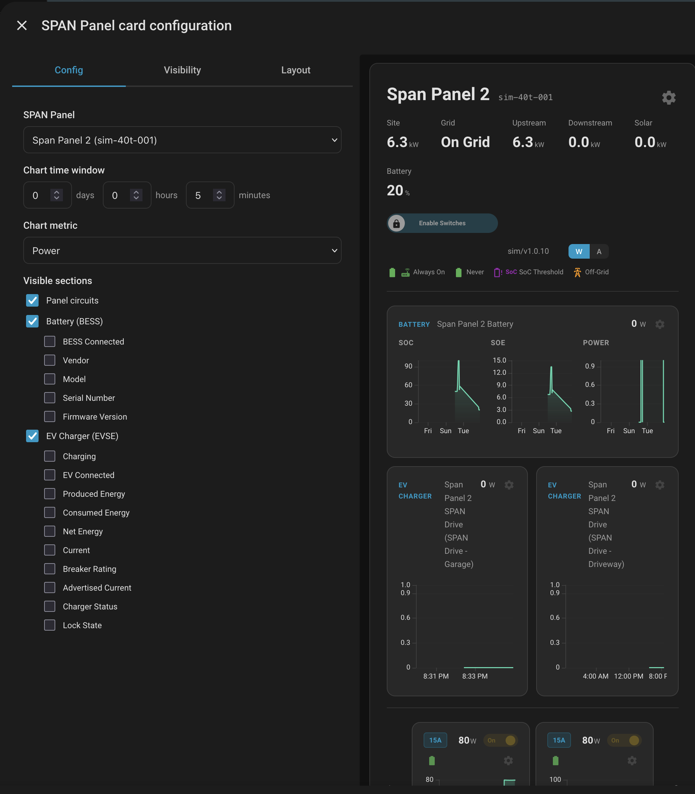

# SPAN Panel Card

A custom Lovelace card for Home Assistant that renders a physical representation of a SPAN electrical panel, showing circuits laid out by their actual tab
positions.



## Features

- Two-column grid matching the physical panel layout (odd tabs left, even tabs right)
- 240V circuits span both columns
- Live power readings with utilization bar
- Breaker rating badges, showing the panel's rating
- Relay on/off status indicators
- Historical power/current charts per circuit
- EVSE, BESS, Solar and solar inverter sub-device sections
- Auto-discovers all circuit entities from a single device selection

## Requirements

- [SPAN Panel integration](https://github.com/SpanPanel/span) **v2.0.5 or later** installed and configured
- Circuits must have `tabs` attributes (included in SPAN Panel integration v1.2+)

## Installation

As of SPAN Panel integration **v2.0.5**, this card is automatically registered as a Lovelace resource by the integration itself — no separate installation is
required. The integration serves the card JS from its own static path and writes the resource entry on setup.

> **Migrating from HACS or manual install?** If you previously installed this card via HACS or manually copied `span-panel-card.js` to your `www/` directory,
> you should:
>
> 1. Remove the HACS-managed dashboard resource (HACS > Dashboard > SPAN Panel Card > Remove) — or delete the manual `/local/span-panel-card.js` resource from
>    **Settings > Dashboards > Resources**
> 2. Remove `span-panel-card.js` from your `config/www/` directory if present
> 3. Restart Home Assistant
>
> The integration will register its own copy of the card automatically on next startup.

## Configuration

The card includes a visual editor accessible through the dashboard UI. You can also configure it manually in YAML.

### Minimal Configuration

```yaml
type: custom:span-panel-card
device_id: <your_span_panel_device_id>
```

### Full Configuration

```yaml
type: custom:span-panel-card
device_id: <your_span_panel_device_id>
history_days: 0
history_hours: 0
history_minutes: 5
chart_metric: power
show_panel: true
show_battery: true
show_evse: true
show_solar: true
```

### Options

| Option                 | Type    | Default        | Description                                                                       |
| ---------------------- | ------- | -------------- | --------------------------------------------------------------------------------- |
| `device_id`            | string  | **(required)** | The Home Assistant device ID of your SPAN Panel                                   |
| `history_days`         | integer | `0`            | Number of days of history to display in charts (0-30)                             |
| `history_hours`        | integer | `0`            | Number of hours of history to display in charts (0-23)                            |
| `history_minutes`      | integer | `5`            | Number of minutes of history to display in charts (0-59)                          |
| `chart_metric`         | string  | `power`        | Metric to display on circuit charts: `power` or `current`                         |
| `show_panel`           | boolean | `true`         | Show the panel circuits grid                                                      |
| `show_battery`         | boolean | `true`         | Show battery (BESS) sub-device section                                            |
| `show_evse`            | boolean | `true`         | Show EV charger (EVSE) sub-device section                                         |
| `show_solar`           | boolean | `true`         | Show the Solar and solar inverter tiles                                           |
| `visible_sub_entities` | object  | `{}`           | Map of entity IDs to booleans controlling which sub-device entities are displayed |

### Solar and Inverter Tiles

Each solar inverter has a tile with its vendor and model, and the power and chart of the circuit that feeds it. The Solar tile is the first inverter's tile,
with the site's total PV power in a **Site total** row beneath it; on a single-inverter site the two numbers are usually close. Where no single panel circuit
feeds the Solar device's inverter, its headline is the site total, captioned **Site total**. An inverter that no panel circuit feeds shows its identity and that
its output is included in the site total. The editor's Battery section now also offers Meter Power and Nameplate Capacity.

### Copying a Tandem's Ratings from the SPAN App

On a MAIN 32, which publishes a tandem breaker as one circuit with the rating of its first breaker, an administrator can copy the other breaker's rating from
the SPAN app, so current monitoring judges the space against both breakers together. Open a circuit's gear in the sidebar dashboard and turn **Monitoring** on:
**Breaker ratings from the SPAN app** sits at the top of the Monitoring section, above the Global/Custom choice. It shows the rating the panel publishes,
read-only, and asks for the other breaker in the space exactly as the SPAN app shows the circuit: for 20-30A, enter 30. It is saved when you press Enter or
leave the field, never while you type, and only as a whole number of amps of 1 or more; anything else is marked for correction. **Remove copied ratings**
returns to the panel's rating. The copy is not a threshold: it is shown in both Global and Custom mode, and choosing Global or resetting thresholds leaves it
alone. It is hidden while monitoring is off for that circuit, and the copy applies again when you turn monitoring back on. The section is not part of the
Lovelace card or the list tabs, which show the panel's rating and do not edit it.

On panels other than MAIN 32 the section is not shown, because the integration takes no copied ratings there: those panels publish each circuit of a multi-load
breaker with its own rating, and a group of circuits that share a meter is judged against the capacity the integration reports for it, what its heaviest space
can carry. The card reads that capacity and adds no ratings up itself. An integration that predates copied ratings offers none, so the section is not shown with
it either.

For a circuit that spans more than one space the panel reports the average of its legs, so one leg can carry more than its breaker while the reading stays under
the rating. No copied rating can show that, so the section offers none there and says instead that turning monitoring off for the circuit is the safer choice.

Thresholds are percentages of the rating a circuit is judged against. Where the thresholds a circuit uses are above 100%, as they may be if you raised them to
quiet a tandem's alerts, the section warns that they now apply to both breakers together, which can let a real overload pass. For the circuit's own it offers
**Use global thresholds**; for the global ones it points to **Global Settings** on the Monitoring tab. The warning follows a threshold change as it is saved.

A copied rating carries a pencil mark wherever the card shows what monitoring judges against, naming the package and the panel's rating, for example "20-20 from
your SPAN app (the panel publishes 20 A)", as its tooltip and, on a tap, in a note beside it. The Monitoring tab has a Rating column, and a circuit's Monitoring
section says what it is judged against, "Judged against 40 A: 20-20 from your SPAN app (the panel publishes 20 A)", so you can see the rating that utilization
and alerts use. The breaker labels on the grid, list and side panel keep showing the panel's own rating. The current chart's limit line, and the utilization the
card works out when the monitor has no figure, use both breakers together only while that circuit's monitoring is on; with it off, or monitoring disabled, they
use the panel's rating. A circuit with no rating shows "no rating". Every open view redraws when a copy changes, whether you changed it here, in another browser
or from a service call: a field you have not touched shows the copy the integration now holds, and one you are typing in keeps what you typed until you press
Enter or leave it. The Monitoring section's threshold and duration fields save the same way, on Enter or when you leave them, and only a whole number in their
range.

### Finding Your Device ID

1. Go to **Settings > Devices & Services**
2. Click your SPAN Panel device
3. The device ID is in the URL: `/config/devices/device/<device_id>`

### History Duration

When `history_days` or `history_hours` are set, `history_minutes` defaults to `0` unless explicitly provided. When neither is set, `history_minutes` defaults to
`5`.

## Data Sources

The card reads the following from the SPAN Panel integration:

| Data                | Source                                     |
| ------------------- | ------------------------------------------ |
| Panel position      | `tabs` attribute on circuit sensors        |
| Power (W)           | Circuit power sensor state                 |
| Breaker rating (A)  | Circuit breaker rating sensor state        |
| Relay on/off        | `relay_state` attribute / switch entity    |
| Voltage             | `voltage` attribute (120V or 240V)         |
| Panel size          | `panel_size` attribute on status sensor    |
| EVSE / BESS / Solar | Sub-devices discovered via `via_device_id` |
